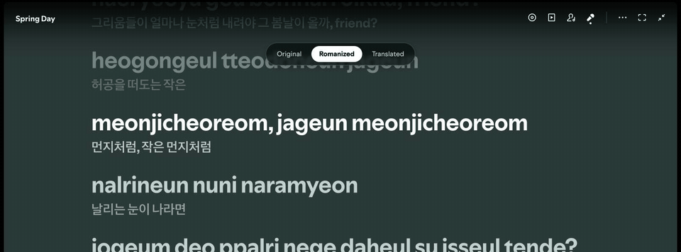
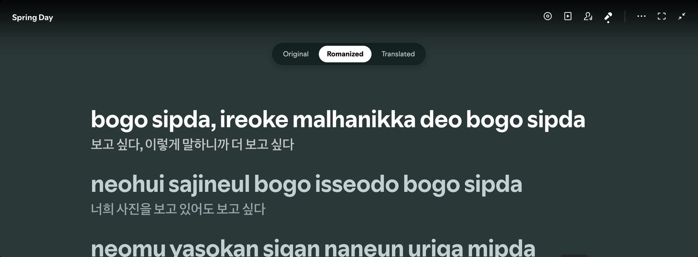
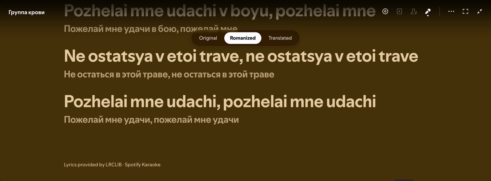
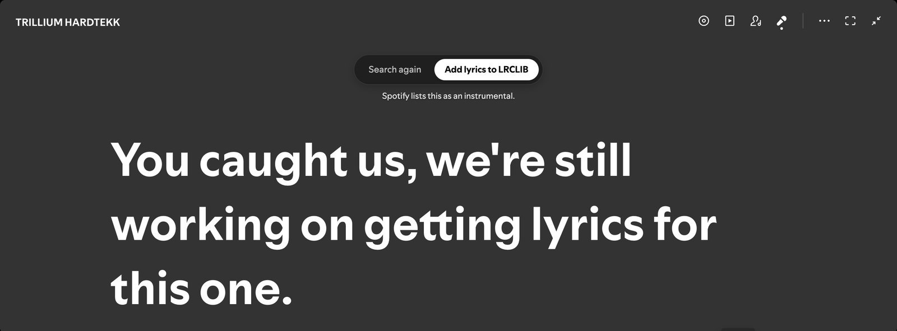
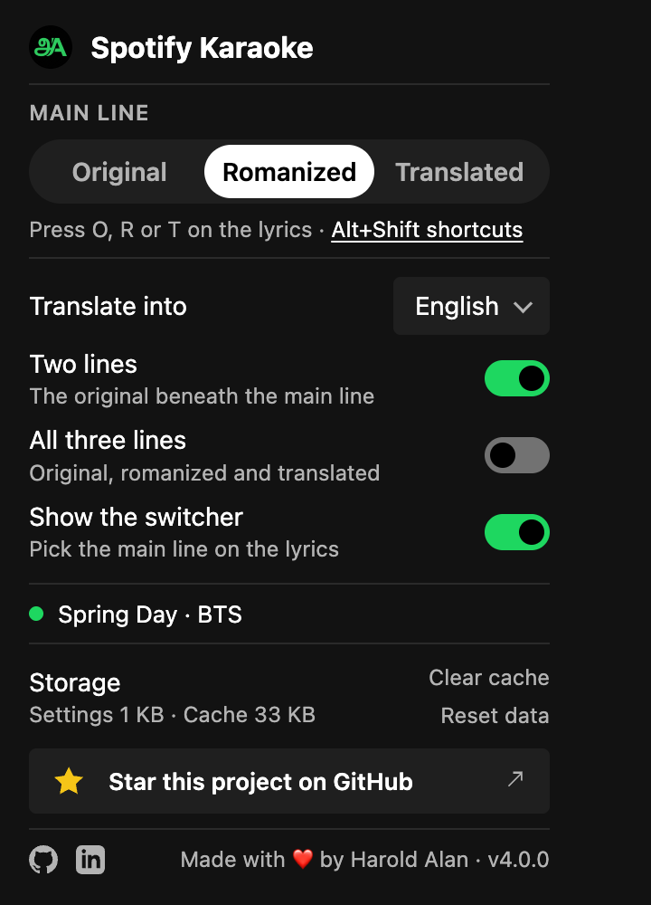

<div align="center">


# Spotify Karaoke

**Romanized and translated lyrics for every song on Spotify's web player — plus the original script restored, and lyrics Spotify doesn't have.**

Free and open source · Chrome · Edge · Firefox · No account, no tracking

<a href="https://chromewebstore.google.com/detail/spotify-karaoke/bhhkohameknlmcgdfafkjplpjalfedie"></a>
<a href="https://addons.mozilla.org/en-US/firefox/addon/spotify-karaoke/"></a>
<a href="https://microsoftedge.microsoft.com/addons/detail/spotify-karaoke-romaniz/gpaojfekocbgcofcbbcinfpnbagjakom"></a>

[](https://chromewebstore.google.com/detail/spotify-karaoke/bhhkohameknlmcgdfafkjplpjalfedie)
[](https://chromewebstore.google.com/detail/spotify-karaoke/bhhkohameknlmcgdfafkjplpjalfedie/reviews)
[](https://github.com/haroldalan/spotify-karaoke/releases)
[](LICENSE)

</div>

<p align="center">
  
</p>

Love a song in Hindi, Korean, Japanese, Tamil or Punjabi but can't read the script — or don't know what it means? Spotify Karaoke turns Spotify's own lyrics view into a karaoke sheet: the lyrics in letters you can read, a translation in your language, and the original underneath, synced line by line as the song plays.

## At a glance

| | |
| :--- | :--- |
| **What it is** | A browser extension for Spotify's web player ([open.spotify.com](https://open.spotify.com)) |
| **What it does** | Romanizes lyrics (Hindi, Korean, Japanese, Chinese, Tamil, Arabic, Russian, Thai and more), translates them into over 130 languages, restores the original script when Spotify shows romanized lyrics, and finds lyrics for songs Spotify has none for |
| **Works in** | Chrome, Edge, Brave and other Chromium browsers; Firefox 142+ — on the desktop. Not the Spotify desktop app or the mobile apps |
| **Spotify account** | Free or Premium |
| **Price** | Free, open source (MIT) |
| **Privacy** | No account, no analytics, nothing sent to the developer. [What is sent where](PRIVACY_POLICY.md) |

---

## Features

### Romanized lyrics: sing along in any script

Pick **Romanized** and every line turns into Latin letters you can sing, with the original right below it. Spotify keeps highlighting and scrolling the lyrics as usual — the extension only changes the text.

<p align="center"></p>

Korean, Japanese (read word by word, as it's pronounced), Chinese pinyin, Hindi and the other Indian scripts, Cyrillic, Thai, Arabic, Hebrew and more. Spellings follow the way listeners write lyrics: *mera dil tera hai*, *kuchh to hai*, *sajjna*.

### Translated lyrics: understand every line

Pick **Translated** and each line is translated into your language — any of over 130 — with the original below it. One request per song, so it's quick and stays quick.

<p align="center"></p>

### The original script, restored

Spotify often shows songs in Hindi, Tamil, Punjabi and other languages in Latin letters, even though they're written in their own script. Spotify Karaoke finds the lyrics in the song's own script on YouTube Music or LRCLIB and Spotify shows those instead — checked line by line to be the same song.

<p align="center"></p>

Romanization and translation then work from the real text, which makes both far better.

### All three lines at once

Turn on **All three lines** to see the romanization, the original and the translation together on every line.

<p align="center"></p>

### Lyrics for songs Spotify has none for

When Spotify has no lyrics, the extension looks on LRCLIB and YouTube Music, and Spotify shows what it finds in its own lyrics view, synced and credited. When Spotify only has unsynced lyrics, a synced copy takes their place.

<p align="center"></p>

If no lyrics exist anywhere, the lyrics view says so, with **Search again** and **Add lyrics to LRCLIB** — share them once and everyone gets them.

<p align="center"></p>

### And more

- **Two lines** — the main line with the original beneath it (on by default), or the main line alone.
- **Wrong lyrics?** — one click in the popup sends a song back to Spotify's own lyrics, with Undo.
- **Everywhere Spotify shows lyrics** — the expanded Now Playing view, the lyrics card in the sidebar, and the mini player.
- **Synced across your devices** — your choices follow you through your browser's sync.
- **Spotify stays Spotify** — highlighting, scrolling, click-to-seek, colours and layouts are Spotify's own.

---

## Install

| Browser | Get it |
| :--- | :--- |
| **Chrome**, Brave, Opera, Vivaldi | [Chrome Web Store](https://chromewebstore.google.com/detail/spotify-karaoke/bhhkohameknlmcgdfafkjplpjalfedie) |
| **Firefox** 142+ | [Firefox Add-ons](https://addons.mozilla.org/en-US/firefox/addon/spotify-karaoke/) |
| **Microsoft Edge** | [Edge Add-ons](https://microsoftedge.microsoft.com/addons/detail/spotify-karaoke-romaniz/gpaojfekocbgcofcbbcinfpnbagjakom) |

Then open [open.spotify.com](https://open.spotify.com), play a song and click Spotify's **Lyrics** button (the microphone in the player bar). Spotify tabs that are already open pick the extension up on their own.

<details>
<summary>Install from a release zip instead (developer mode)</summary>

1. Download the zip for your browser from the [Releases page](https://github.com/haroldalan/spotify-karaoke/releases) and extract it.
2. **Chrome / Edge:** open `chrome://extensions` (or `edge://extensions`), turn on **Developer mode**, click **Load unpacked** and pick the extracted folder.
3. **Firefox:** open `about:debugging#/runtime/this-firefox`, click **Load Temporary Add-on…** and pick `manifest.json` in the extracted folder. Temporary add-ons are removed when Firefox restarts; use the store for a permanent install.

</details>

## How to use it



- **The switcher** at the top of Spotify's lyrics: `Original` · `Romanized` · `Translated`. For a Latin-script song it offers Original and Translated; for a song already in your language it stays out of the way.
- **Keys** with the lyrics open: `O`, `R`, `T`. From anywhere in the browser: `Alt+Shift+O`, `Alt+Shift+R`, `Alt+Shift+T` (change them on your browser's shortcuts page).
- **The popup** (click the extension's icon): the main line, the language to translate into, **Two lines**, **All three lines**, **Show the switcher**, the song playing with **Search again** or **Wrong lyrics?**, and storage.

<br clear="right">

## Languages and scripts

| Script | Languages | Romanized |
| :--- | :--- | :--- |
| Devanagari, Gurmukhi, Gujarati, Bengali, Odia, Telugu, Kannada, Malayalam, Tamil | Hindi, Marathi, Nepali, Punjabi, Gujarati, Bengali, Odia, Telugu, Kannada, Malayalam, Tamil | On your device, spelled the way lyrics are written |
| Hangul | Korean | On your device |
| Kanji and kana | Japanese | On your device, word by word, as pronounced (は "wa", を "o") |
| Hanzi | Chinese | On your device, pinyin with tones |
| Cyrillic | Russian, Ukrainian, Bulgarian, Serbian and more | On your device |
| Thai | Thai | On your device, word by word |
| Greek, Georgian, Armenian | Greek, Georgian, Armenian | On your device |
| Arabic, Hebrew, Lao, Khmer, Burmese, Sinhala, Ethiopic | Arabic, Persian, Urdu, Hebrew, Lao, Khmer, Burmese, Sinhala, Amharic | By Google Translate |

Translation into over 130 languages is by Google Translate. Japanese kanji the on-device dictionary doesn't know are read by Google too. A line that mixes scripts — a Hindi phrase in a Tamil song, an English hook in a K-pop song — is romanized part by part, and English stays as it is.

## FAQ

**How do I get romanized lyrics on Spotify?**
Install Spotify Karaoke, open a song's lyrics on [open.spotify.com](https://open.spotify.com) and pick **Romanized**. Korean, Japanese, Chinese, Hindi, Tamil, Arabic, Russian, Thai and many more scripts are covered.

**How do I translate Spotify lyrics into English (or my own language)?**
Pick **Translated** on the lyrics, and choose the language in the popup under **Translate into**.

**Why does Spotify show Hindi, Tamil or Punjabi lyrics in English letters?**
Spotify's lyrics provider often serves an automatic romanization for these songs. Spotify Karaoke restores the original script when a copy exists on YouTube Music or LRCLIB.

**Spotify says "Lyrics aren't available". Can it still show lyrics?**
Yes, when LRCLIB or YouTube Music has them. If nobody does, you can add them to LRCLIB from the lyrics view.

**Does it work in the Spotify desktop app or on my phone?**
No. It works in Spotify's web player in Chrome, Edge, Brave and other Chromium browsers, and Firefox, on a computer.

**Do I need Spotify Premium?**
No. Free and Premium both work. (The mini player is a Premium feature of Spotify's.)

**Is it free? Is it safe?**
Free and open source, under the MIT licence. No account, no analytics, nothing sent to the developer. Song titles go to LRCLIB and YouTube Music to find lyrics, and lyric lines to Google Translate to translate them — see the [privacy policy](PRIVACY_POLICY.md).

**Something's wrong. What can I try?**
- *No lyrics showing:* open them with Spotify's Lyrics button (the microphone).
- *Lyrics were found but Spotify still says there are none:* Spotify keeps its answer until the page reloads; the extension offers to reload, now or after the song.
- *The lyrics are for another song:* **Wrong lyrics?** in the popup.
- *Just added lyrics to LRCLIB:* **Search again** looks right away (a song with no lyrics is otherwise checked again after 3 days).
- *Anything else:* **Clear cache** in the popup, then reload the Spotify tab. Still stuck? [Open an issue](https://github.com/haroldalan/spotify-karaoke/issues/new/choose).

---

## Privacy

No account, no analytics, no ads, and nothing is ever sent to the developer. Settings sync through your browser; caches stay on your device. To do its job the extension sends a song's title, artist, album and duration to LRCLIB and YouTube Music, and its lyric lines to Google Translate. The [privacy policy](PRIVACY_POLICY.md) lists every request.

Spotify Karaoke is an independent open-source project, not affiliated with or endorsed by Spotify AB.

## For developers

```bash
git clone https://github.com/haroldalan/spotify-karaoke.git
cd spotify-karaoke
npm install
npm run build          # .output/chrome-mv3   (npm run build:firefox, npm run build:edge)
npm test               # unit tests
```

How it works: [ARCHITECTURE.md](ARCHITECTURE.md) — the short version is that Spotify's lyrics view is never rebuilt; the extension changes the lyrics Spotify receives and how each line's text is drawn. What it's for: [PROBLEM.md](PROBLEM.md). The dev kit, live testing and releases: [docs/development.md](docs/development.md). Contributions are welcome — see [CONTRIBUTING.md](CONTRIBUTING.md). What changed: [CHANGELOG.md](CHANGELOG.md).

## Support

Found a bug or have an idea? [Open an issue](https://github.com/haroldalan/spotify-karaoke/issues/new/choose) or [ping me on Discord](https://discord.com/users/370486976643727360). If Spotify Karaoke helps you sing along, a ⭐ on GitHub or a review on the [Chrome Web Store](https://chromewebstore.google.com/detail/spotify-karaoke/bhhkohameknlmcgdfafkjplpjalfedie/reviews), [Firefox Add-ons](https://addons.mozilla.org/en-US/firefox/addon/spotify-karaoke/reviews) or [Edge Add-ons](https://microsoftedge.microsoft.com/addons/detail/spotify-karaoke-romaniz/gpaojfekocbgcofcbbcinfpnbagjakom/reviews) goes a long way — or [buy me a coffee](https://ko-fi.com/haroldalan).

<p align="center"><sub>Made by Harold Alan · MIT licence</sub></p>
