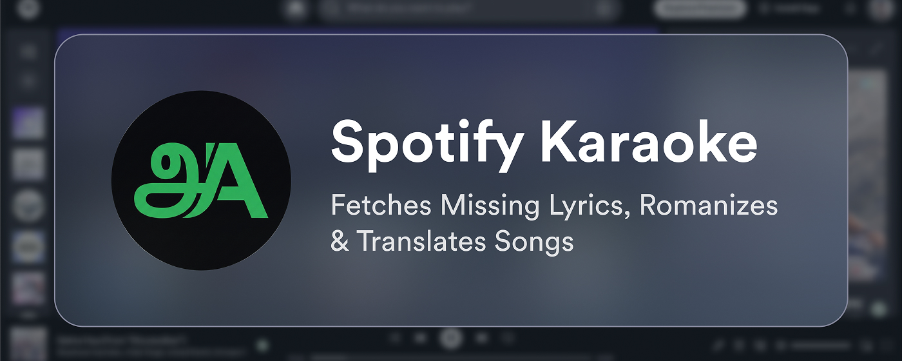
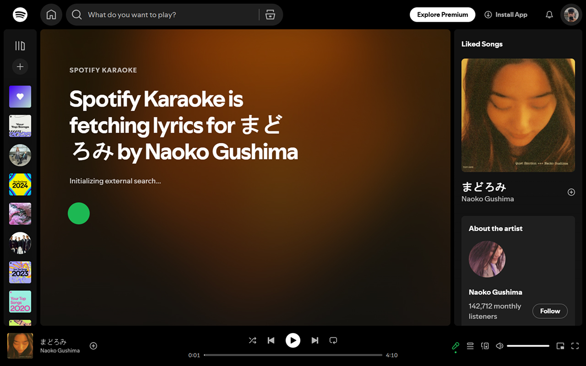
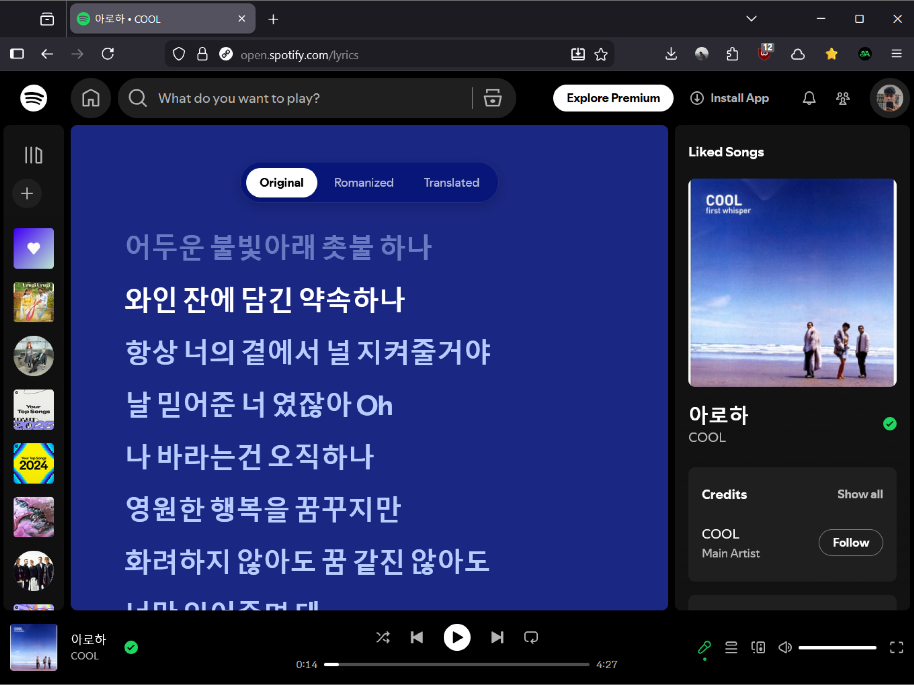
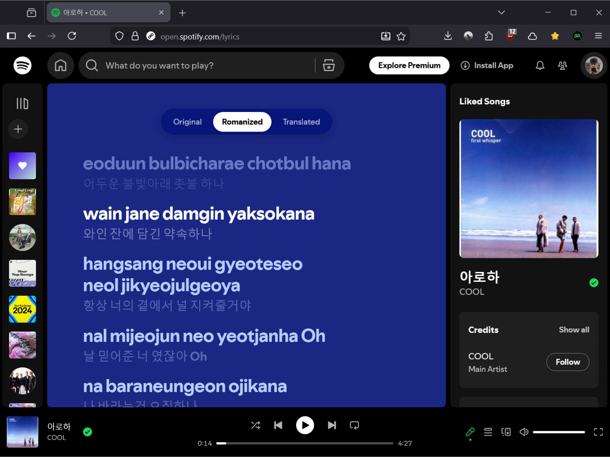
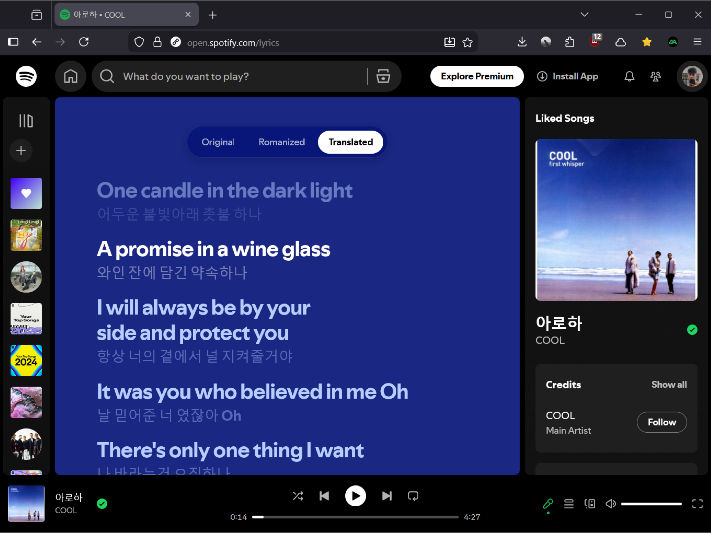

<div align="center">
  <h1>
  </h1>
  <p>Automatically fetches synced lyrics for songs that don't have it, and provides additional functionality like romanization for all scripts and translation into over 130 languages — right inside Spotify</p>
  
  <a href="https://chromewebstore.google.com/detail/spotify-karaoke/bhhkohameknlmcgdfafkjplpjalfedie" target="_blank"></a>
  <a href="https://addons.mozilla.org/en-US/firefox/addon/spotify-karaoke/" target="_blank"></a>
  <a href="https://microsoftedge.microsoft.com/addons/detail/spotify-karaoke-romaniz/gpaojfekocbgcofcbbcinfpnbagjakom" target="_blank"></a>
  <br><br>
  
  
  
  
</div>

> [!NOTE]
> **Version 4.0.0 is a rebuild.** It no longer redraws Spotify's lyrics view: it changes the lyrics Spotify receives and how each line is drawn, so Spotify's own highlighting, scrolling, click-to-seek and layouts keep working. Your settings carry over from 3.x. See the [changelog](CHANGELOG.md).

---

## Key Features

<table>
<tr>
<td align="center">
<br>

<br>
<b>Smart Lyrics Fetch</b><br>
When Spotify can't find lyrics, the extension fetches them automatically.<br><br>
<code>Lyrics not available</code> → <code>Synced lyrics found</code>
<br><br>
</td>
<td align="center">
<br>

<br>
<b>Phonetic Romanization</b><br>
Any script, with local engines for the major writing systems and the spellings listeners use.<br><br>
<code>안녕하세요</code> → <code>annyeonghaseyo</code>
<br><br>
</td>
</tr>
<tr>
<td align="center">
<br>

<br>
<b>Real-time Translation</b><br>
Read lyrics in over 130 languages to understand the meaning behind every line.<br><br>
<code>君を愛してる</code> → <code>I love you</code>
<br><br>
</td>
<td align="center"> 
<br>

<br>
<b>Native Restoration</b><br>
When Spotify serves a song romanized, the original script comes back automatically.<br><br>
<code>mera dil tera hai</code> → <code>मेरा दिल तेरा है</code>
<br><br>
</td>
</tr>
<tr>
<td align="center" colspan="2">
<br>

<br>
<b>All Three Lines</b><br>
Original, romanized and translated text together, in one synced line.<br><br>
<code>君を愛してる</code> / <code>kimi o aishiteru</code> / <code>I love you</code>
<br><br>
</td>
</tr>
</table>

## Demo reel

<video src="https://github.com/user-attachments/assets/f6afc346-9dc0-4429-8733-5c8df94c8eaf" controls="controls" muted="muted" style="max-width: 100%;"></video>

---

## What it does

Spotify's lyrics panel has two problems: it sometimes can't find lyrics at all, and when it does, it often can't help you understand them. `Spotify Karaoke` fixes both.

**Smart lyrics fetching:** When Spotify has no lyrics for a song, the extension looks on YouTube Music and LRCLIB, and Spotify shows what it finds in its own lyrics view, synced, with Spotify's own highlighting, credited in Spotify's footer ("Lyrics provided by LRCLIB · Spotify Karaoke"). When Spotify only has unsynced lyrics, a synced copy in the same script replaces them. No user action required.

<br>
<p align="center">
  
</p>
<br>

**Romanization & Translation:** Once lyrics are on screen — whether fetched or Spotify's — you choose the main line:

- **Original** — lyrics as Spotify shows them, unchanged.
- **Romanized** — any non-Latin script (Japanese, Korean, Chinese, Arabic, Indic, Thai, Cyrillic, etc.) in the Latin alphabet for instant sing-along.
- **Translated** — lyrics translated into any of over 130 languages.

Switch between them with the switcher on the lyrics, the popup, or the keyboard. No page reload, no flicker, and Spotify keeps following the song.

**Native script restoration:** Spotify often serves romanized lyrics for songs written in another script (Hindi, Tamil, Punjabi and more). The extension finds the original-script lyrics on YouTube Music or LRCLIB and Spotify shows them instead. Romanized and Translated then work from the real text, which romanizes and translates far better.

**Two lines** — the main line with the original beneath it, in a smaller size (on by default). Off, the main line alone.

**All three lines** — original, romanization and translation together, in every mode.

**Songs with no lyrics anywhere** — the lyrics view says so, with **Search again** and **Add lyrics to LRCLIB**. Instrumentals are named as such when Spotify says so.

**Wrong lyrics?** — if a fetched or restored copy is the wrong song, the popup sends that song back to Spotify's own lyrics (with Undo).

**Everywhere Spotify shows lyrics** — the expanded Now Playing view, the lyrics card in the Now Playing sidebar, and the mini player.

**Cross-device Sync** — your mode, translation language and switches sync across your devices via `storage.sync`.

| Original (Korean) | Romanized |
| :---: | :---: |
|  |  |

| Translated |
| :---: |
|  |

---

## Controls

| Method | How |
| :--- | :--- |
| **Switcher** | The `[Original] [Romanized] [Translated]` switch at the top of Spotify's lyrics. For a song already in Latin script it offers Original and Translated; for a song already in your translation language it doesn't show. |
| **Extension popup** | The same choice, plus the translation language, **Two lines**, **All three lines** and **Show the switcher**, the song playing (with **Search again** or **Wrong lyrics?**), and storage. |
| **Keyboard** | With the lyrics open, press `O` (Original), `R` (Romanized) or `T` (Translated). Ignored while you type in a text field. `Alt+Shift+O`, `Alt+Shift+R` and `Alt+Shift+T` work from anywhere in the browser (change them on your browser's shortcuts page). |

> [!NOTE]
> The switcher and the `O`/`R`/`T` keys work while Spotify's lyrics are open. Click the Lyrics (microphone) button in the player bar.

Turn off **Show the switcher** in the popup for a completely unobstructed lyrics view, and use the keys or the popup.

---

## Installation

### 🌐 Official Browser Stores (Recommended)
- **[Chrome Web Store](https://chromewebstore.google.com/detail/spotify-karaoke/bhhkohameknlmcgdfafkjplpjalfedie)** — Chrome, Brave, and other Chromium browsers.
- **[Firefox Add-ons](https://addons.mozilla.org/en-US/firefox/addon/spotify-karaoke/)** — Mozilla Firefox 142 or later.
- **[Microsoft Edge Add-ons](https://microsoftedge.microsoft.com/addons/detail/spotify-karaoke-romaniz/gpaojfekocbgcofcbbcinfpnbagjakom)** — Microsoft Edge.

### 🛠️ Manual Installation (Developer Mode)

If you wish to test the latest features before they hit the stores, you can install the extension manually.

#### Google Chrome / Brave / Opera
1. Download the latest release `.zip` from the **[Releases page](../../releases)** and extract it.
2. Open your browser and navigate to `chrome://extensions/`.
3. Enable **Developer mode** (usually a toggle in the top-right corner).
4. Click **Load unpacked** and select the folder where you extracted the extension.

#### Mozilla Firefox
> [!IMPORTANT]
> **Firefox Limitation:** Temporary add-ons are removed when the browser restarts. For a permanent install, please use the [Firefox Add-ons store](#-official-browser-stores-recommended).
1. Download and extract the latest release `.zip` (the Firefox one).
2. Open Firefox and navigate to `about:debugging#/runtime/this-firefox`.
3. Click **Load Temporary Add-on...**.
4. Select the `manifest.json` file inside the extracted folder.

#### Microsoft Edge
1. Download and extract the latest release `.zip`.
2. Navigate to `edge://extensions/`.
3. Enable **Developer mode** (toggle in the bottom-left sidebar).
4. Click **Load unpacked** and select the folder where you extracted the extension.

---

## Native Script Restoration for Non-Latin Scripts

Spotify often serves romanized fallback lyrics for songs written in another script (Indian languages above all).

When Spotify's lyrics for a song look romanized while the track's language has its own script, the extension asks YouTube Music and LRCLIB for a copy in that script at the same time, YouTube Music's (licensed) copy first. A copy is used only when it is the same song: the extension romanizes it and checks that it reads like Spotify's lines, line by line, or, when the two break their lines differently, as a whole text, with timings that agree. When one is found, Spotify shows the original script; otherwise Spotify's romanized lyrics stay. Not every song has an original-script copy available.

Romanized and Translated then work from the original script, producing significantly more accurate results.

---

## Romanization Coverage

| Script | Engine | Where |
| --- | --- | --- |
| **Japanese** (Kanji + Kana) | Kuromoji word readings + `@sglkc/kuroshiro`, read as pronounced (は "wa", を "o"); Google Translate for kanji the dictionary doesn't know | Local (+ API) |
| **Korean** (Hangul) | `@romanize/korean` | Local |
| **Chinese** (Hanzi) | `pinyin-pro` | Local |
| **Tamil** | `tamil-romanizer` | Local |
| **Hindi, Punjabi, Gujarati, Bengali, Telugu, Kannada, Malayalam, Odia** | Built-in on `@indic-transliteration/sanscript`, spelled the way lyrics are usually written ("mera dil tera hai", "sajjna") | Local |
| **Cyrillic** (Russian, Ukrainian and more) | `cyrillic-to-translit-js` | Local |
| **Thai** | Built-in word-by-word reading close to RTGS; `@dehoist/romanize-thai` for words it can't parse | Local |
| **Greek, Georgian, Armenian** | `transliteration` | Local |
| **Arabic, Persian, Urdu, Hebrew, Lao, Khmer, Burmese, Sinhala, Amharic** | Google Translate's romanization | API |
| **Translation** (over 130 languages) | Google Translate | API |

> ⚡ **Local** — instant, runs entirely in your browser. &nbsp; 🌐 **API** — a network request (one per song, never one per line).

A line that mixes scripts (a Hindi phrase in a Tamil song) is romanized by script, each with its own engine; English words are kept as written.

---

## Under the Hood

| Component | Detail |
| :--- | :--- |
| **The idea** | Spotify's lyrics view is never rebuilt. The extension changes the lyrics Spotify receives (its own network requests) and how each line's text is drawn (attributes and CSS). React's nodes are never created, moved or removed |
| **Interception** | A page script at `document_start` in the page's world sees Spotify's track metadata and lyrics responses. For a song without lyrics it answers Spotify's request itself, in Spotify's format |
| **Smart lyrics fetch** | LRCLIB and YouTube Music; synced before unsynced; title, artist and duration must match |
| **Ahead of time** | Spotify fetches the next song's lyrics early; the extension processes them then, so song changes are instant |
| **Cache** | `storage.local`, up to 2,000 entries, oldest dropped first: lyrics found (30 days synced, 7 days unsynced), "none found" (3 days; 30 minutes when a source failed), romanizations (30 days), translations (60 days) |
| **Translation** | Google Translate, one request per song; a backup endpoint when the main one refuses; pauses (1 min doubling to 30 min) when Google rate-limits, never retrying in a loop |
| **Browser support** | Chrome MV3 · Edge MV3 · Firefox MV3 (142+) |

How it all fits together: [ARCHITECTURE.md](ARCHITECTURE.md). What it is for, in priority order: [PROBLEM.md](PROBLEM.md).

---

## Developer Setup

**Requirements:** Node.js 22

```bash
git clone https://github.com/haroldalan/spotify-karaoke.git
cd spotify-karaoke
npm install

npm run build          # .output/chrome-mv3 (Edge: npm run build:edge)
npm run build:firefox  # .output/firefox-mv3
npm run zip && npm run zip:firefox && npm run zip:edge   # store zips + Firefox sources zip

npm test               # unit tests
npm run typecheck      # TypeScript check
npm run dev            # rebuilt and reloaded on every change
npm run build:devkit   # standalone build with the dev kit (__skDev in Spotify's console)
```

Releases: pushing a `v*` tag builds, tests, creates the GitHub release and submits to all three stores (`.github/workflows/release.yml`). The workflow can also be run by hand for an existing tag, for chosen stores, with a credentials-only dry run.

More for developers (the dev kit, live testing in Chrome and Firefox, project status): [docs/development.md](docs/development.md).

### Project Structure

```
entrypoints/
  background.ts          # Service worker: lyrics, romanization, translation, caches
  page.content.ts        # Page world, document_start: Spotify's fetch hook
  spotify.content.ts     # Isolated world: decoration, switcher, notice
  popup/                 # The popup
src/
  page/                  # Fetch hook, Spotify's response formats, page <-> content channel
  content/               # Line store, decoration, view, switcher, modes, keys
  background/            # lyrics/ (LRCLIB, YouTube Music, matching, native script), text/ (romanizers, Google), cache, header rules
  shared/                # Types, messages, settings, scripts, languages
tests/                   # Unit tests (vitest)
tools/live/              # Live-test driver for Chrome and Firefox, header check
```

---

## Troubleshooting

**Why aren't lyrics showing?**
Make sure Spotify's lyrics are open: click the Lyrics (microphone) button in the player bar. For a song with no lyrics anywhere, the lyrics view says so and offers **Search again**.

**Lyrics were found, but Spotify still says there are none.**
Spotify keeps its earlier answer until the page loads again. The extension offers to reload, now or after the song ends.

**These lyrics are for another song.**
Open the popup and click **Wrong lyrics?**: the song goes back to Spotify's own lyrics. **Undo** brings ours back.

**Something looks stuck.**
Open the popup and click **Clear cache** (everything is looked up again) or **Reset data** (also resets your settings), then reload the Spotify tab.

**I just uploaded lyrics to LRCLIB, but they still aren't showing up!**
A song with no lyrics anywhere is remembered for 3 days. Click **Search again** in the lyrics view or the popup to look right away.

---

## Contributing

Issues, ideas, and PRs are welcome — especially for romanization accuracy improvements or new script support.

1. Fork the repository.
2. Create a feature branch: `git checkout -b feature/your-feature`
3. Commit your changes: `git commit -m 'feat: describe what you added'`
4. Push and open a Pull Request.

Please keep PRs focused. One feature or fix per PR makes review much faster.

---

## Privacy & Disclaimer

> [!NOTE]
> **No personal data is collected**, and nothing is sent to the developer. Settings are stored in `browser.storage.sync`, caches in `browser.storage.local` on your device. To find, romanize and translate lyrics, the extension sends a song's title, artist, album and duration to LRCLIB and YouTube Music, and its lyric lines to Google Translate. See the extension's full [privacy policy](https://haroldalan.github.io/spotify-karaoke/PRIVACY_POLICY.html) and [Google's Privacy Policy](https://policies.google.com/privacy).

> [!WARNING]
> Spotify Karaoke is not affiliated with or endorsed by Spotify AB. It is an independent open-source project that modifies the Spotify web player UI for personal and accessibility use.

---

## Support & Feedback

<a href="https://discord.com/users/370486976643727360" target="_blank">
  
</a>

If you encounter any bugs, have suggestions for new features, or just want to chat about the project, feel free to reach out!

---

<div align="center">

[](LICENSE)
[](https://ko-fi.com/haroldalan)
[](https://chromewebstore.google.com/detail/spotify-karaoke/bhhkohameknlmcgdfafkjplpjalfedie/reviews)
[](https://addons.mozilla.org/en-US/firefox/addon/spotify-karaoke/reviews)
[](https://microsoftedge.microsoft.com/addons/detail/spotify-karaoke-romaniz/gpaojfekocbgcofcbbcinfpnbagjakom/reviews)

*Made by Harold Alan. If you find it useful, a ⭐ on GitHub goes a long way.*

</div>
